# Phase 1 — Target Architecture

Based on the Phase 0 audit (`docs/audit/PHASE0-AUDIT.md`). No code has been written yet — this is a proposal.

---

## TL;DR

- **Keep**: TanStack Start/Router, React 19, Vite, Tailwind v4, the 11 shadcn primitives actually in use, Zod, the overall server-function pattern, and the existing `companies`/`reviews`/`salaries` data shape as the starting point for the new schema.
- **Change the build target**: swap the Lovable-preset's Cloudflare-flavored Nitro for the standard `node-server` Nitro preset, drop the `@lovable.dev/vite-tanstack-config` black box in favor of an explicit, plain `vite.config.ts`. Small, mechanical, low-risk.
- **Biggest decision, flagged explicitly below**: **drop Supabase as a platform** (both hosted Postgres and Auth) and move to a Railway-provisioned Postgres with first-party auth (argon2id, server-side sessions, our own email verification). This is the one call in this document I'm making without being able to fully confirm your intent — see "The Supabase question" below. Everything else in this doc assumes that decision; if you want to keep Supabase instead, tell me now and I'll redraft before Phase 2.
- **New for Phase 2/3**: `data_sources`, `salary_benchmarks`, `occupations`, `audit_log`, `review_disputes`, `ingestion_jobs` tables; `reviews`/`salaries` gain moderation status and provenance columns.
- **No Redis, no message broker, no Elasticsearch, no worker service** — Postgres `tsvector` for search, a Postgres-backed `ingestion_jobs` table plus a Railway Cron trigger for scheduled ingestion, and hand-rolled Postgres-backed counters for rate limiting.
- **Deploy**: single Docker container (TanStack Start in Node-server mode) + Railway managed Postgres, Railway primary, Render/Fly documented as alternates.

---

## The Supabase question

This is the fork the rest of the document depends on, so it goes first, not buried.

**What the audit found:** the current app uses Supabase for both hosted Postgres *and* Auth (email/password + Google via a Lovable-specific broker), with all writes going through a service-role client that bypasses RLS (Phase 0 §5). It works today.

**What Phase 3 of this plan asks for**, verbatim: *"Use email + password with a proper KDF (argon2id or bcrypt), email verification, secure session cookies, CSRF protection, and rate limiting on auth and submission endpoints."* That is a description of building your own auth system. You don't specify a KDF, session cookie handling, or CSRF strategy for a service that already does all of that for you — Supabase Auth's whole pitch is that you never touch those primitives directly. So Phase 3 as written only makes sense if the plan is to **not** use Supabase Auth.

**Constraint math also doesn't favor keeping Supabase.** The brief calls for "one managed Postgres instance" provisioned as part of Railway/Render/Fly (Phase 4 says explicitly: *"Postgres provisioned as a Railway service, wired via `DATABASE_URL`"*), under $20/mo total. Supabase is a separate hosted platform with its own billing: its free tier auto-pauses a project after a week of inactivity (unacceptable for something meant to be live), and its paid tier starts at $25/mo — which alone exceeds the entire budget before the app container is even counted.

**My recommendation: drop Supabase entirely.** New Postgres on Railway (or Render/Fly's managed Postgres for the alternates), first-party auth built directly on that same database. This also happens to resolve two things Phase 0 flagged as rewrite blockers on their own: the Lovable-specific OAuth broker (`@lovable.dev/cloud-auth-js`) and the two-parallel-authorization-systems smell (service-role bypassing RLS while RLS policies sit mostly unused). One database, one auth system, one place authorization logic lives.

**The real cost of this call:** you lose Supabase Studio's dashboard-as-admin-UI, you lose free hosted Auth (email templates, magic links, provider management) and have to build a slice of that yourself, and existing user passwords (bcrypt via Supabase's GoTrue) can't be copied byte-for-bit into a different KDF. The migration plan below handles that with a lazy-rehash-on-login pattern rather than forcing a mass password reset, but it's real work, not free.

**If you'd rather keep Supabase** (accepting the $25/mo Pro tier as a deliberate budget override, and accepting that Phase 3's auth section becomes "verify what Supabase Auth already gives us" rather than "build it"), say so now — that changes §3 (module boundaries), §5 (auth), and §8 (cost) below, and Phase 2/3 execution would look meaningfully different. Everything from here assumes the drop-Supabase path.

---

## 1. Chosen stack

| Layer | Choice | Change from today | Reasoning |
|---|---|---|---|
| Runtime | Node 22 LTS, pinned via `engines` + `.nvmrc` + Docker base image | New pin | Audit flagged the total absence of a pinned version (Phase 0 §1). |
| App framework | TanStack Start + TanStack Router | **Keep** | Already works, file-based routing is fine, server functions are a reasonable RPC layer. Rewriting this wholesale to Next/Remix/Express would throw away a working, largely-correct application layer to chase no real benefit. |
| Build / server preset | Nitro, **`node-server` preset**, plain `@tanstack/react-start` Vite plugin | **Change** | Audit flagged the current Lovable-wrapped config defaulting to Cloudflare Workers (Phase 0 §1, §9) — wrong runtime model for a single-container deploy. This is a config change, not a rewrite: same routes, same server functions, different Nitro target and a hand-written `vite.config.ts` instead of the opaque `@lovable.dev/vite-tanstack-config` wrapper. |
| Database | Postgres, **Railway-managed** (primary), Render/Fly managed Postgres for the alternates | **Change** (was Supabase-hosted) | See "The Supabase question" above. |
| ORM / migrations | **Drizzle ORM** + `drizzle-kit` | New | TypeScript-first, SQL-shaped (no hidden query magic), first-class `tsvector`/generated-column support for the full-text search requirement, lightweight migration files that are easy to review in PRs. Chosen over Prisma for a smaller runtime footprint and because Drizzle's schema-as-TypeScript pairs naturally with the Zod validators already in this codebase (`drizzle-zod` generates Zod schemas straight from the Drizzle table definitions, removing a whole class of "the validator and the schema drifted" bugs). |
| Auth | First-party: **argon2id** via `@node-rs/argon2`, server-side sessions in Postgres, httpOnly signed cookies | New (replaces Supabase Auth) | Argon2id is the modern default (OWASP's current recommendation over bcrypt). `@node-rs/argon2` is a native Rust binding — fast, no pure-JS KDF performance tax. Server-side sessions (not stateless JWT) so a session can be instantly revoked (needed for "moderator bans a user," admin actions, etc.) without a token-blocklist workaround. |
| OAuth (Google) | **Arctic** (`arctic` npm package) | Replaces `@lovable.dev/cloud-auth-js` | Small, framework-agnostic OAuth 2.0/OIDC client library, no hosted broker in the middle, no dependency on staying inside Lovable Cloud. Talks to Google directly. |
| Transactional email | **Resend** | New | Needed for email verification + password reset, which the app didn't have to handle before (Supabase did it). Resend's free tier (3,000 emails/mo) comfortably covers a low-traffic launch; simple API, no SMTP config to manage. |
| Full-text search | Postgres `tsvector` generated columns + GIN indexes | New (search didn't meaningfully exist before) | Required by the brief; Postgres FTS is more than adequate at this data scale — no Elasticsearch. |
| Background/scheduled jobs | Railway Cron Job → internal script/endpoint, status tracked in an `ingestion_jobs` table | New | Ingestion sources (BLS/DOL/ONS) update quarterly-to-annually, not continuously — a general-purpose job queue (pg-boss, BullMQ) would be solving a problem this app doesn't have. A cron trigger calling a plain async function, with a Postgres table recording start/end/status/row-counts, is the boring answer and satisfies the brief's own "or a scheduled task" clause without a new dependency. |
| Rate limiting | Hand-rolled Postgres-backed counters (sensitive writes) + in-memory token buckets (cheap reads) | New (didn't exist before) | No Redis needed at single-container scale — see §6. |
| CSRF | SameSite=Lax cookies + double-submit token on state-changing requests | New | Standard, no new dependency. |
| Validation | Zod (+ `drizzle-zod` to generate schemas from tables) | Keep, extend | Already the house style. |
| UI | React 19, Tailwind v4, shadcn/ui (trimmed to the ~11 primitives in real use, plus whatever Phase 3's new screens need), lucide-react | Keep, trim | Per Phase 0 §2/§12 — delete the 34 unused primitives and their now-orphaned dependencies (`recharts`, `react-day-picker`, `embla-carousel-react`, `cmdk`, `vaul`, `input-otp`, `react-resizable-panels`, `react-hook-form`, `@hookform/resolvers`) rather than carry them into the rebuild. |
| Testing | **Vitest** (unit/integration) + **Playwright** (e2e/auth flows) | New | Vitest because it's Vite-native (zero extra bundler config) and fast; Playwright because it's already proven out in this project's manual verification workflow and is the standard choice for browser-driven auth-flow tests. |
| Deploy | Multi-stage Dockerfile, non-root user, Node-server Nitro output | New | Required by Phase 4; see §9. |

---

## 2. Module boundaries (modular monolith)

One deployable, one codebase, one database — but internal seams so each concern is independently testable and no route reaches into another module's tables directly.

```
src/
  modules/
    auth/           sessions, password hashing, email verification, CSRF, rate limiting
    companies/       company CRUD, slug logic, full-text search
    reviews/         review submission, moderation state, edit/redact, disputes
    salaries/        user-submitted salary reports, aggregation
    ingestion/        Phase 2 adapters, occupation normalizer, salary_benchmarks writes
    admin/           audit log, admin-on-behalf actions, moderation queue, dashboard queries
    db/              Drizzle schema, client, migrations (shared by all modules above)
  routes/            TanStack Start file-based routes — thin: call into modules, render UI
  components/         shared UI
```

**Rule:** a route file may import from `modules/*`'s public entry point (`modules/reviews/index.ts` etc.), never reach past it into `modules/reviews/db-queries.ts` directly, and never import another module's internals. Each module owns its slice of the Drizzle schema and is the only code that writes to its tables — e.g. only `modules/reviews` writes to the `reviews` table; `modules/admin`'s audit-log writer calls `modules/reviews`'s "redact" function rather than updating the row itself, so the audit log can never be bypassed by a future shortcut.

This mirrors the existing `src/lib/*.functions.ts` pattern (already organized by domain — `companies.functions.ts`, `admin-reviews.functions.ts`) — it's a reorganization into folders with enforced boundaries, not a new paradigm.

---

## 3. Full-text search

Generated `tsvector` columns + GIN indexes, no new infrastructure:

```sql
alter table companies add column search_vector tsvector
  generated always as (
    setweight(to_tsvector('english', coalesce(name, '')), 'A') ||
    setweight(to_tsvector('english', coalesce(industry, '')), 'B') ||
    setweight(to_tsvector('english', coalesce(description, '')), 'C')
  ) stored;
create index companies_search_idx on companies using gin (search_vector);
```

Same pattern for an `occupations` search vector (title + aliases), used by both the salary explorer's occupation filter and the free-text title normalizer in Phase 2's ingestion adapters. Query via `websearch_to_tsquery` (handles natural phrases like `"software engineer" -intern` without the caller needing to know tsquery syntax) and rank with `ts_rank`.

---

## 4. Background / scheduled jobs

No worker service, no queue library. Concretely:

- An `ingestion_jobs` table: `id, source_id, started_at, finished_at, status (running|success|failed), rows_ingested, error_message, triggered_by (cron|manual)`.
- Each Phase 2 adapter is a plain async function: `runOewsIngestion(): Promise<IngestionResult>`, etc.
- A **Railway Cron Job** (a first-class Railway service type — runs a command on a schedule against the same deployed image, no separate always-on process) invokes a small CLI entrypoint (`npm run ingest -- --source=oews`) quarterly/annually per source, which calls the adapter function and writes a row to `ingestion_jobs`.
- The same adapter functions are callable from the admin dashboard's "run ingestion now" button — same code path, `triggered_by: 'manual'`. No queue needed because there's no scenario here with high job volume or need for distributed workers; it's a handful of scheduled batch imports.
- Render and Fly both have equivalent scheduled-task primitives (Render Cron Jobs; Fly Machines run-on-schedule) — documented as alternates in §9, same `ingestion_jobs` table either way.

---

## 5. Auth architecture

- `users(id, email unique, email_verified_at nullable, password_hash, password_algo, created_at)`. `password_algo` lets us store `'bcrypt'` for lazily-migrated legacy rows and `'argon2id'` for everything else (see §7).
- `sessions(id, user_id, token_hash, created_at, expires_at, user_agent, ip)` — the cookie holds a random opaque token; only its hash is stored (so a DB read alone can't forge a session, same principle as password hashing). Session lookup = hash the cookie value, look up by `token_hash`. Expiry: sliding window, refreshed on use, hard cap at 30 days.
- `email_verification_tokens` / `password_reset_tokens(id, user_id, token_hash, expires_at, used_at)` — single-use, short expiry (verification: 24h, reset: 1h).
- **Roles**: keep the existing `user_roles(user_id, role)` shape and the `admin`/`moderator`/`user` enum as-is — it was already correctly designed in the current schema, it just needs to reference the new `users.id` instead of Supabase's `auth.users.id`. `moderator` gets real enforcement this time (Phase 0 §3 flagged it as schema-only today).
- **Rate limiting**: a `rate_limit_events(key, endpoint, window_start, count)` table for auth endpoints and submission endpoints (`login`, `signup`, `submitReview`, `submitSalary`, `addCompany`) — sliding-window counters checked/incremented in the same transaction as the write. Cheap, unauthenticated reads (search) use an in-memory leaky-bucket per-process instead — acceptable because the target is a single container (§9), and losing that in-memory state on redeploy is a non-issue for a search-throttle.
- **CSRF**: session cookie set `SameSite=Lax`, plus a per-session CSRF token issued to the client and required as a custom header (`X-CSRF-Token`) on every non-GET server function call, checked against the session record. Standard double-submit pattern, no new dependency.
- **Email verification**: required before a user can submit a review or salary report (not before browsing/reading) — matches the existing product's "anonymous read, gated write" posture without blocking casual visitors.

---

## 6. Target ER diagram

```mermaid
erDiagram
    users ||--o{ sessions : has
    users ||--o{ user_roles : has
    users ||--o{ reviews : authors
    users ||--o{ salary_reports : authors
    users ||--o{ audit_log : "acts as admin"
    users ||--o{ email_verification_tokens : has
    users ||--o{ password_reset_tokens : has

    companies ||--o{ reviews : receives
    companies ||--o{ salary_reports : receives
    companies ||--o{ review_disputes : "disputed on"
    companies }o--o{ salary_benchmarks : "matched employer (nullable)"

    reviews ||--o{ review_disputes : "flagged by"
    reviews ||--o{ audit_log : "target of"

    occupations ||--o{ salary_reports : normalizes
    occupations ||--o{ salary_benchmarks : normalizes

    data_sources ||--o{ salary_benchmarks : provides
    data_sources ||--o{ ingestion_jobs : "ingested via"

    users {
        uuid id PK
        text email UK
        timestamptz email_verified_at
        text password_hash
        text password_algo
        timestamptz created_at
    }
    sessions {
        uuid id PK
        uuid user_id FK
        text token_hash UK
        timestamptz created_at
        timestamptz expires_at
    }
    user_roles {
        uuid id PK
        uuid user_id FK
        enum role
    }
    companies {
        uuid id PK
        text name
        text slug UK
        text industry
        text description
        text website
        tsvector search_vector
        timestamptz created_at
    }
    reviews {
        uuid id PK
        uuid company_id FK
        uuid user_id FK "nullable"
        text job_title
        text location
        text employment_status
        text employment_tenure
        numeric rating_overall
        numeric rating_work_life
        numeric rating_culture
        numeric rating_compensation
        numeric rating_career_growth
        text pros
        text cons
        enum submission_source "self_submitted|admin_on_behalf|imported"
        enum status "pending|approved|rejected|redacted"
        text original_text "pre-redaction snapshot, nullable"
        timestamptz created_at
        timestamptz edit_window_expires_at
    }
    salary_reports {
        uuid id PK
        uuid company_id FK
        uuid user_id FK "nullable"
        uuid occupation_id FK "nullable"
        text job_title
        numeric experience_years
        text country
        text region
        text city
        numeric pay_amount
        text pay_currency
        text pay_period
        numeric annual_pay_normalized
        enum status "pending|approved|rejected"
        timestamptz created_at
    }
    salary_benchmarks {
        uuid id PK
        uuid source_id FK
        text source_url
        timestamptz ingested_at
        text country
        text region
        text city
        uuid occupation_id FK
        uuid employer_id FK "nullable, matched companies.id"
        text employer_name "nullable, raw source text"
        numeric pay_p10
        numeric pay_p25
        numeric pay_p50
        numeric pay_p75
        numeric pay_p90
        text pay_currency
        int sample_size
        enum confidence "high|medium|low"
    }
    occupations {
        uuid id PK
        text soc_code UK
        text title
        text[] aliases
        tsvector search_vector
    }
    data_sources {
        uuid id PK
        text name
        text licence
        text url
        timestamptz last_ingested_at
    }
    ingestion_jobs {
        uuid id PK
        uuid source_id FK
        timestamptz started_at
        timestamptz finished_at
        enum status "running|success|failed"
        int rows_ingested
        text error_message
        enum triggered_by "cron|manual"
    }
    audit_log {
        uuid id PK
        uuid admin_user_id FK
        text action
        text target_table
        uuid target_id
        text justification
        timestamptz created_at
    }
    review_disputes {
        uuid id PK
        uuid review_id FK
        uuid company_id FK
        text raised_by_contact
        text reason
        enum status "open|resolved|dismissed"
        uuid resolved_by FK "nullable"
        timestamptz created_at
    }
    email_verification_tokens {
        uuid id PK
        uuid user_id FK
        text token_hash UK
        timestamptz expires_at
        timestamptz used_at
    }
    password_reset_tokens {
        uuid id PK
        uuid user_id FK
        text token_hash UK
        timestamptz expires_at
        timestamptz used_at
    }
```



**Deliberately dropped from the current schema**: `company_aggregates`. Per Phase 0 §3, its `benchmark_rating`/`source` values have no verifiable provenance and nothing in the current codebase writes to it. Carrying it forward would violate Phase 2's own "coverage honesty" requirement — better to show an honest "no reviews yet" state than an unlabeled legacy number. If you know of a real, citable source behind today's `company_aggregates` rows, tell me and I'll route it through `salary_benchmarks`/a rating equivalent with proper provenance instead of dropping it.

**Deliberately dropped column**: `companies.logo_url` — confirmed unused anywhere in the UI (Phase 0 §3). Can come back trivially if/when logo upload is actually built.

---

## 7. Migration path & data preservation

**Before this can be executed, I need one confirmation from you:** does the live Supabase project (`kdlcnqyksajwnyjvvmnu`, referenced in `supabase/config.toml`) have real rows worth keeping, or is it effectively empty/seed data? The plan below assumes there might be something worth preserving; if it's empty, most of this section is skippable and Phase 2 can start from a clean schema.

Assuming there is data worth keeping:

1. **Export.** `pg_dump` against Supabase's direct Postgres connection string for `public.companies`, `public.reviews`, `public.salaries`, `public.user_roles`, and `auth.users` (email, `encrypted_password`, `email_confirmed_at` only — no other auth metadata is needed).
2. **Provision.** New Railway Postgres instance; run Drizzle migrations to create the schema in §6.
3. **Map and load**, table by table:
   - `companies` → `companies` — 1:1 on `name`/`slug`/`industry`/`description`/`website`; `logo_url` dropped.
   - `auth.users` → `users` — `email`, `email_verified_at ← email_confirmed_at`. `password_hash ← encrypted_password`, `password_algo ← 'bcrypt'` (Supabase/GoTrue hashes are bcrypt). **No plaintext password ever exists to migrate** — see the lazy-rehash pattern below for what happens at next login.
   - `user_roles` → `user_roles` — re-point `user_id` to the new `users.id` via email match (join old `auth.users.email` → new `users.email`).
   - `reviews` → `reviews` — direct field mapping; `collection_method` → `submission_source` (`organic`/`self-service` → `self_submitted`, `tele-calling` → `admin_on_behalf`, `import` → `imported`); every migrated row gets `status = 'approved'` (it was already public under the old system, migration shouldn't silently re-hide it) and `original_text = null`. `rating_career_growth` and `employment_tenure` will be `null` for all migrated rows — the old schema never captured them.
   - `salaries` → `salary_reports` — direct field mapping; `user_id` will be `null` for every migrated row (the old schema had no ownership column at all — Phase 0 §3). `pay_currency = 'INR'`, `pay_period = 'annual'` for all of them.
   - `company_aggregates` — **exported and set aside, not auto-loaded** (see §6 reasoning). Hand it to you as a CSV for a manual call on whether any of it is worth re-entering with real sourcing.
4. **Password migration — lazy rehash, not a forced reset.** On a migrated user's first login post-cutover: verify the submitted password against the stored bcrypt hash (bcrypt verification doesn't require knowing argon2id); if it matches, re-hash with argon2id and update `password_hash`/`password_algo` in the same request. Users who never come back stay on bcrypt indefinitely, which is fine — bcrypt isn't broken, it's just not our new default for freshly-created accounts.
5. **Cutover.** Given the traffic level implied by Phase 0 (no analytics/scale signals suggesting this is high-traffic), a short maintenance-window cutover (point the app at the new `DATABASE_URL`, disable writes for the export duration, which should be minutes at this data size) is simpler and more boring than a dual-write migration — recommended over building a zero-downtime path for a project this size.

---

## 8. Rate limiting & CSRF — why no Redis

The brief requires justifying any Redis usage. Rate limiting is the one place a project like this often reaches for Redis; it's not needed here because:
- Single container (§9) — no cross-instance state to synchronize, so even in-memory counters work for the cheap-read case.
- Sensitive-write limits (auth, submissions) use Postgres directly — the row you're about to check-and-increment is one query, in the same transaction as the write it's guarding, and this app's write volume (human-submitted reviews/salaries, not high-frequency events) is nowhere near where Postgres row-locking on a counters table would become a bottleneck.
- If traffic ever grows enough that this becomes a real contention point, that's a good problem to have and a one-line swap to a managed Redis add-on at that point — not a reason to add the operational surface area now.

---

## 9. Deployment & cost

**Container**: multi-stage Dockerfile — `deps` stage (install), `build` stage (`vite build` with `node-server` Nitro preset), `runtime` stage (`node:22-alpine`, non-root user, only the built output + production `node_modules` copied in). Healthcheck path: `/health` (new — Phase 0 §4 confirmed none exists today), returning DB connectivity status.

**Railway (primary)**:
- `railway.toml` — build via Dockerfile, start command `node .output/server/index.mjs` (Nitro node-server output path), healthcheck `/health`.
- Railway-managed Postgres service, wired via the `DATABASE_URL` Railway injects automatically.
- Railway Cron Job service for scheduled ingestion (§4).
- **Cost shape** (verify current published pricing before committing — I can't fetch live pricing from here): a small always-on container (well under 1 vCPU / 512MB–1GB at this traffic level) plus a small Postgres instance is the kind of workload Railway's usage-based Hobby tier is built for. Realistically low tens of dollars ceiling at idle-to-low traffic; confirm against Railway's current calculator before treating $20/mo as guaranteed rather than targeted.

**Render (alternate)**: `render.yaml` blueprint — one Web Service (Docker, same image) + one managed Postgres. Render Cron Job for ingestion. Functionally equivalent shape to Railway.

**Fly.io (alternate)**: `fly.toml` — one Fly App (same Docker image) on a shared-cpu-1x machine, Fly Postgres (or Fly's managed Postgres via a partner) attached. Fly Machines' scheduled-run feature substitutes for the cron job.

All three get the *same* Dockerfile and the *same* `DATABASE_URL`-shaped connection — the only per-host artifacts are the thin `railway.toml`/`render.yaml`/`fly.toml` manifests.

---

## 10. Open questions before Phase 2 starts

1. **Supabase**: confirmed dropping it, per the recommendation above? (Proceeding on that assumption unless you say otherwise.)
2. **Existing data**: does the live Supabase project have real rows worth migrating, or is §7 moot?
3. **Email sending**: OK with Resend specifically, or is there an existing transactional-email account/vendor you'd rather I target instead?
4. **`company_aggregates`**: confirmed OK to drop rather than migrate (see §6)?

---

**STOP. Awaiting your approval before Phase 2.**
